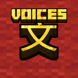
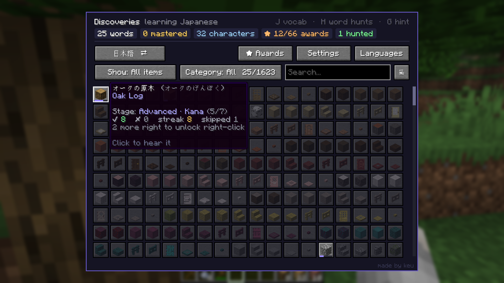

# LinguaCraft Voices

### Hear every word you learn.

**[Download](https://github.com/ke-u/linguacraft-voices/releases/latest)** &nbsp;·&nbsp;
**[Installation](#installation)** &nbsp;·&nbsp;
**[FAQ](#faq)** &nbsp;·&nbsp;
**[LinguaCraft](https://github.com/ke-u/linguacraft)** &nbsp;·&nbsp;
**[Report a bug](https://github.com/ke-u/linguacraft-voices/issues)**

---

## About

**LinguaCraft Voices** is the optional, recommended add-on for **[LinguaCraft](https://github.com/ke-u/linguacraft)**. It gives every word in the mod a real spoken voice, so you learn how it sounds as well as how it's written.

> **This is an add-on.** It does nothing on its own: you need **LinguaCraft** installed too.

---

## Features

**Every word, spoken**
Every block, item, mob and potion effect is spoken in every language LinguaCraft teaches, including Catalan, Georgian, Kazakh, Korean, Portuguese (Portugal) and Chinese (Traditional), new in 1.1.

**Hear it when you need it**
Words play when a prompt asks for them. Press **Hear it** (or **R** on the side card) to hear the word again during any prompt, or click any word in your Discoveries (**J**). Set how loud they are with *Voice volume* in Settings.

**Word hunts come alive**
A word hunt plays the word you're looking for, louder and faster the closer you get. You can change the volume for each distance in Settings.

**Counting, too**
Add **[LinguaCraft Counting](https://github.com/ke-u/linguacraft-counting)** and amounts are spoken as well: 三块圆石, two stacks of apples, два железных меча.

**No internet needed**
All the audio is in the jar. Nothing is streamed or generated while you play.

---

## Installation

**With a launcher (CurseForge app, Modrinth App, Prism):** install **LinguaCraft** in a Fabric profile (1.20.1, 1.21.1 or 26.3), then add **LinguaCraft Voices** to the same profile.

**By hand**
1. Install **LinguaCraft** and **Fabric API** first.
2. Download the latest `linguacraft-voices-x.x.x.jar` from the **[releases page](https://github.com/ke-u/linguacraft-voices/releases/latest)**.
3. Put it in your `.minecraft/mods` folder, next to `linguacraft-x.x.x+<your version>.jar`.
4. Launch the game. LinguaCraft finds the voices by itself, with no setup needed.

---

## Compatibility

| | |
|---|---|
| **Minecraft** | 1.20.1, 1.21 / 1.21.1 and 26.3. One jar works on all of them. |
| **LinguaCraft** | 1.2.0 or newer for every language (older versions use the languages they have). |
| **Servers** | Client only. Nothing to install on a server. |

---

## FAQ

<b>Do I need it?</b>

 
No. LinguaCraft works fine without it: you'll still see every word, you just won't hear it. But hearing the words is a big part of learning them, which is why it's recommended.

<b>A word sounds wrong. What do I do?</b>

 
<a href="https://github.com/ke-u/linguacraft-voices/issues">Open an issue</a> with the language and the word. Fixes go into the next release.

---

## Permissions

The audio in this add-on is licensed under **[CC BY 4.0](https://creativecommons.org/licenses/by/4.0/)**. You may change it, remix it and share it, including in your own projects, as long as you credit **LinguaCraft Voices by keu** and keep the voice credits from `NOTICE.txt`.

- **Modpacks:** Yes, add it to your modpack as normal.
- **Videos and streams:** Go for it, no need to ask.

---

## Support the mod

LinguaCraft and its voices are free and always will be. If they've helped you learn a few words and you'd like to say thanks,
you can **[buy me a coffee on Ko-fi](https://ko-fi.com/linguacraft)**. It's never expected, but always appreciated.

---

## Credits

**Made by keu**

- Voices made with the open text-to-speech models [Kokoro](https://huggingface.co/hexgrad/Kokoro-82M) and [Piper](https://github.com/rhasspy/piper)
- The add-on's `NOTICE.txt` lists the voice used for each language and its licence

LinguaCraft Voices by keu. Audio licensed under CC BY 4.0. NOT AN OFFICIAL MINECRAFT PRODUCT. NOT APPROVED BY OR ASSOCIATED WITH MOJANG OR MICROSOFT.
